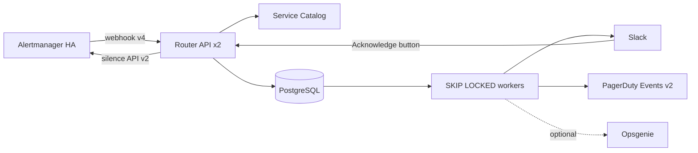

# obs-notification-router

Alertmanager bildirimlerini servis kataloğuyla zenginleştiren, doğru Slack/PagerDuty hedefine yönlendiren ve acknowledge edilmemiş page'leri beş dakika sonra escalate eden dayanıklı Go servisi.

## Neden bu tasarım?

- **PostgreSQL, Redis değil:** escalation transition'ları, acknowledge yarışı, silence aynası, transactional outbox ve audit aynı ACID sınırında kalıyor. Redis seçilse audit için yine kalıcı ikinci bir store gerekecek, iki sistem arasında tutarlılık sorunu doğacaktı.
- **Strategy pattern:** `notify.Strategy` Slack, PagerDuty ve Opsgenie'yi aynı `Send` kontratının arkasında tutar. Yeni bir sağlayıcı registry'ye eklenir; routing engine veya worker değişmez.
- **Transactional outbox:** webhook dış API beklemeden veriyi kalıcılaştırır ve `202` döner. Worker sekiz denemeye kadar exponential backoff uygular; pod restart teslimatı kaybettirmez.
- **İki ayrı idempotency anahtarı:** event key firing/resolved outbox kayıtlarını ayırır; incident key aynı flapping penceresindeki olayları tek PagerDuty incident'ında birleştirir. `DEDUP_WINDOW=10m` ve hedef başına dakika limiti çift koruma sağlar.
- **Catalog source of truth:** Slack kanalı ve mantıksal PagerDuty servis adı manifestten gelir. Gizli PagerDuty routing key manifestte tutulmaz; `PAGERDUTY_ROUTING_KEYS_JSON` secret'ında eşlenir.

Detaylı karar tablosu, akış diyagramı ve state machine: [docs/routing.md](docs/routing.md). API sözleşmesi: [docs/openapi.yaml](docs/openapi.yaml).

## Mimari



`page` için primary Slack + PagerDuty gider. Beş dakika içinde Slack butonu veya `POST /v1/acknowledgements` çağrılmazsa secondary Slack + PagerDuty outbox kayıtları ile state değişimi tek transaction'da gerçekleşir. `resolved`, aynı PagerDuty `dedup_key` ile incident'ı kapatır.

## Service Catalog kontratı

Router aşağıdaki iki endpoint'i bekler:

```http
GET /v1/services/{service}
Authorization: Bearer $CATALOG_TOKEN

{"service":{"name":"payments-api","team":"payments","owner":"team-payments","slack_channel":"#payments-alerts","escalation_slack_channel":"#payments-leads","pagerduty_service":"payments-primary","escalation_pagerduty_service":"platform-oncall","opsgenie_team":"payments","runbook_url":"https://runbooks.acme.com/payments-api","repository_url":"https://github.com/acme/payments-api","last_deploy_at":"2026-09-17T09:00:00Z"}}
```

```http
GET /v1/identity/slack/{user_id}/teams

{"teams":["payments"]}
```

İkinci endpoint `/mute` komutunda write-own kontrolünü sağlar. Catalog bulunamazsa alert kaybolmaz: fallback Slack kanalına, `page` ise ayrıca platform PagerDuty servisine gider ve audit detayında `fallback=true` tutulur. Catalog kaydı var fakat alert `team` label'ı farklıysa güvenli biçimde reddedilir.

## Çalıştırma

Gereksinimler: Go 1.24+, PostgreSQL 15+.

```bash
cp .env.example .env
docker compose up -d postgres
set -a; source .env; set +a
go run ./cmd/router
```

Uygulama migration'ları embed eder ve başlangıçta PostgreSQL advisory lock altında çalıştırır. Gerekli secret alanları:

| Değişken | İçerik |
|---|---|
| `DATABASE_URL` | PostgreSQL DSN |
| `ALERTMANAGER_WEBHOOK_TOKEN` | Alertmanager → router bearer token |
| `API_TOKENS_JSON` | API token → takım eşlemesi; `platform` tüm servisleri mute edebilir |
| `SLACK_BOT_TOKEN` | `chat:write` scope'lu bot token |
| `SLACK_SIGNING_SECRET` | Slash command ve interaction HMAC doğrulaması |
| `PAGERDUTY_ROUTING_KEYS_JSON` | Mantıksal servis → Events API v2 routing key |
| `CATALOG_TOKEN` | Catalog service token |

Tüm ayarlar ve gerçekçi varsayılanlar [.env.example](.env.example) dosyasındadır. Slack App'te command URL `/v1/slack/commands`, Interactivity URL `/v1/slack/interactions` olmalıdır. İstek imzası ve beş dakikalık replay penceresi doğrulanır.

## Mute API

```bash
curl -X POST https://notification-router.obs.acme.com/v1/mutes \
  -H 'Authorization: Bearer TEAM_API_TOKEN' \
  -H 'Content-Type: application/json' \
  -d '{"service":"payments-api","for":"2h","reason":"database maintenance"}'
```

Süre 5 dakika–7 gün aralığındadır. Slack karşılığı `/mute payments-api 2h` şeklindedir. Router Alertmanager `/api/v2/silences` üzerinde hem `service` hem `team` matcher'ı yaratır ve yerel audit kaydını tutar.

## Alertmanager kurulumu

[deploy/alertmanager-values.yaml](deploy/alertmanager-values.yaml), `kube-prometheus-stack` altındaki `alertmanager` values bölümüyle doğrudan merge edilir; aynı içeriğin bağımsız ve `amtool` ile doğrulanabilir karşılığı [deploy/alertmanager-config.yaml](deploy/alertmanager-config.yaml) dosyasındadır. `notification-router-webhook` secret'ı `token` key'i içermelidir. Routing tree `page` için `group_wait: 0s`, daha düşük severity'ler için 15 saniye kullanır; page aynı alertin warning/info kopyalarını, warning ise info kopyasını inhibit eder.

[deploy/kubernetes.yaml](deploy/kubernetes.yaml) iki replica, PDB, zone spread, non-root/read-only container ve namespace izolasyonlu NetworkPolicy içerir. Slack/PagerDuty egress'i FQDN NetworkPolicy standartta olmadığı için yalnız public `:443` CIDR'larına açıktır; Cilium kullanılıyorsa bunu FQDN policy ile daraltın.

## Audit ve veri modeli

`audit_log` append-only olay tablosudur: `occurred_at`, `event_type`, `actor`, `team`, `service`, `alert_fingerprint`, `strategy`, `destination`, `outcome`, `detail jsonb`. Alert kabulü, teslim, acknowledge ve silence creation kaydedilir. Secret/token hiçbir audit detayına yazılmaz.

`notification_outbox` üzerindeki `(event_key, strategy, destination, stage)` unique constraint tekrar teslim planlamasını önler. Worker'lar `FOR UPDATE SKIP LOCKED` ile yatay ölçeklenir. Hedef başına `delivery_rate_limits` sayacı flapping/fan-out patlamasını sınırlar.

## Opsgenie notu

Opsgenie adapter'ı mevcut müşteriler için `OPSGENIE_ENABLED=true` ile çalışır; standalone Opsgenie ürününün kapanış süreci nedeniyle yeni kurulumlarda varsayılan kapalıdır. Ayrı Strategy implementasyonu olduğundan Jira Service Management veya başka bir on-call sağlayıcısına geçiş routing katmanını etkilemez.

## Test

```bash
go test ./...
go test -race ./...
```

Routing testleri üç takım × üç severity matrisinin tamamını kapsar. Slack ve PagerDuty integration testleri gerçek HTTP payload/header davranışını `httptest` sunucularıyla doğrular. PostgreSQL escalation state-machine testi `TEST_DATABASE_URL` verildiğinde çalışır; GitHub Actions bu servisi otomatik sağlar.
