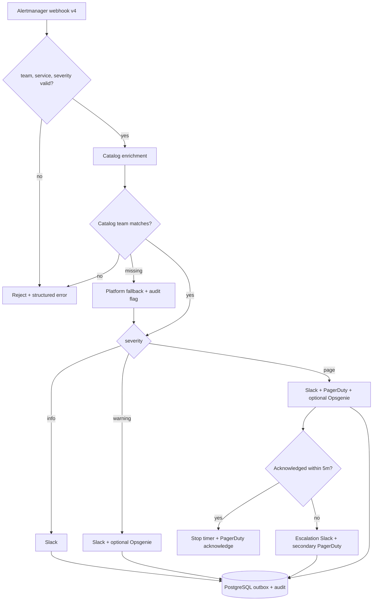
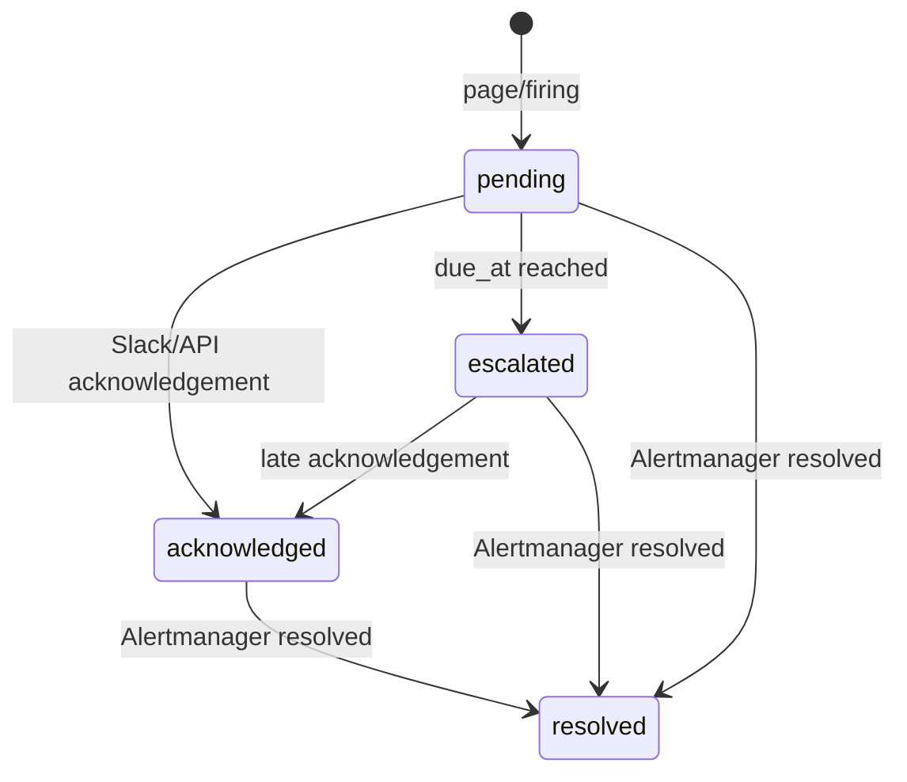

# Routing decision tree

Required labels are `team`, `service`, and `severity`. `critical` is accepted as a backward-compatible alias for `page`; `warn` maps to `warning`. A catalog record whose team conflicts with the alert is rejected instead of leaking an alert to the wrong team.

| Alert status | Severity | Primary destinations | After 5 minutes without acknowledgement |
|---|---|---|---|
| firing | info | Service's Slack channel | — |
| firing | warning | Service's Slack channel; Opsgenie team when enabled | — |
| firing | page | Service's Slack channel + PagerDuty service; Opsgenie when enabled | Escalation Slack channel + secondary PagerDuty service |
| resolved | any | Resolve/update the same primary destinations | Pending escalation becomes `resolved` |
| any | invalid/missing required label | Rejected and recorded in structured logs | — |
| any | catalog entry missing | Platform fallback channel; page also goes to platform PagerDuty | Uses platform escalation defaults |

## Escalation state machine

Claiming a due escalation, creating both secondary-delivery outbox rows, and moving the state to `escalated` occur in one PostgreSQL transaction with `FOR UPDATE SKIP LOCKED`. Multiple replicas can therefore run workers without double escalation or a crash gap.

